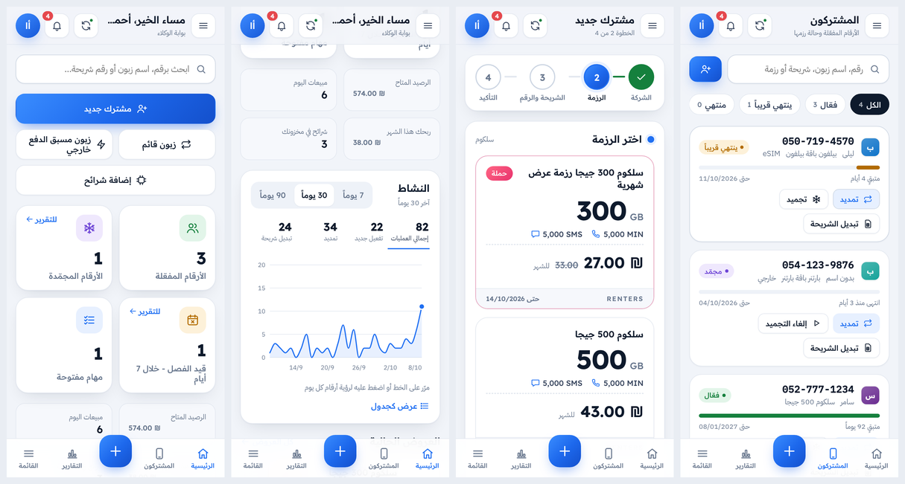
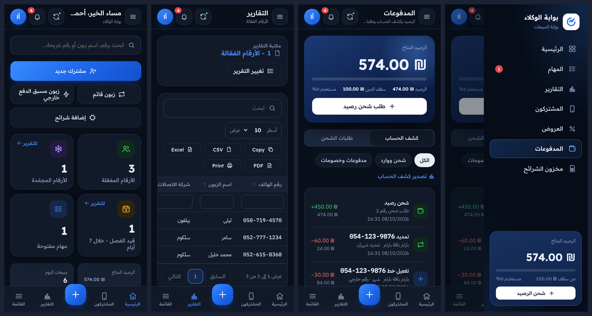
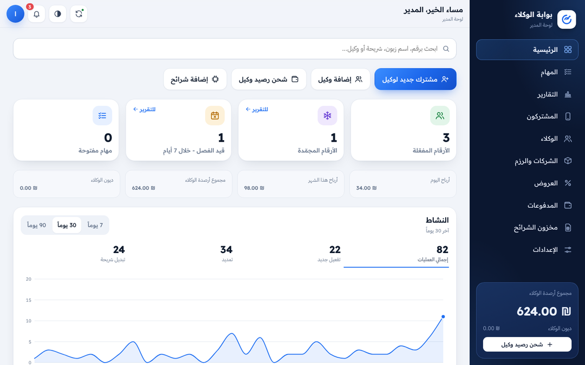

# بوابة الوكلاء

تطبيق للهاتف (PWA يُثبَّت من المتصفح على الشاشة الرئيسية) مع خادم خاص به، لبيع خطوط سلكوم وبارتنر وبيلفون وهوت موبايل عبر وكلاء.
لكل وكيل اسم مستخدم وكلمة مرور، والمدير يتحكم بالأسعار والأرصدة والرزم.





> الصور من بيانات تجريبية.

## ما الذي يفعله

**للوكيل**
- **الرئيسية:** تحية حسب الوقت، بحث سريع (رقم، اسم زبون، شريحة)، أزرار سريعة: مشترك جديد، زبون قائم، زبون مسبق الدفع خارجي، إضافة شرائح؛
  بطاقات: الأرقام المفعّلة، المجمّدة، قيد الفصل خلال 7 أيام، المهام المفتوحة؛ رسم «النشاط» لآخر 7/30/90 يوماً مع تفاصيل كل يوم.
- **مشترك جديد في 4 خطوات** مع «ملخص الطلبية» يتحدّث في كل خطوة: الشركة ← الرزمة (العروض تظهر بعلامة «حملة») ← الشريحة والرقم (eSIM، تحويل رقم، المدة 1–12 شهراً) ← التلخيص وسعر الزبون وربحك.
- **الشريحة:** امسح باركود الشريحة بالكاميرا (Chrome على أندرويد)، أو اخترها من مخزونك بلمسة، أو اكتبها. تتعرّف المنصّة على الشركة من أول أرقام الشريحة وتمنع تفعيل شريحة شركة على رزمة شركة أخرى.
- **زبون قائم:** تمديد رزمة أي رقم؛ يُضاف التمديد من تاريخ الانتهاء الحالي فلا يضيع على الزبون أي يوم.
- **المشتركون:** كل رقم مع شريط الأيام المتبقية، وتجميد/إلغاء تجميد، تبديل الشريحة، فصل، تعديل بيانات الزبون، ومشاركة التفاصيل عبر واتساب. رمز eSIM يظهر للزبون كـ QR.
- **المهام:** الرزم التي تنتهي قريباً (للتمديد قبل الفصل) وطلباتك للمدير.
- **المدفوعات:** الرصيد المتاح وسقف الدين، كشف الحساب، وطلب شحن رصيد مع صورة الإيصال.
- **التقارير:** مكتبة تقارير (الأرقام الفعّالة، شرائح بانتظار الفصل، المنتهية، المجمّدة، التفعيلات، التمديدات، تبديل الشرائح، كشف الحساب، المبيعات حسب الرزمة، أرباحك من الزبائن، مخزون الشرائح)
  مع بحث وتصفية لكل عمود وترتيب وترقيم صفحات وتصدير Copy / CSV / Excel / PDF / Print.
- **العروض، مخزون الشرائح، التنبيهات** (رصيد منخفض، أرقام تنتهي، عروض جديدة، ردود المدير)، والوضع الداكن.

**للمدير**
- كل ما سبق لكل الوكلاء، مع التكلفة والربح.
- **الوكلاء:** إضافة/تعديل/إيقاف/حذف، اسم المستخدم وكلمة المرور، الرصيد (شحن، خصم، تعيين)، **سقف دين** لكل وكيل، نقل رصيد بين وكيلين،
  و**سعر خاص لكل وكيل لكل رزمة** مع أداة «خصم على كل الرزم».
- **الشركات والرزم:** الشعار (رفع صورة) واللون وبادئات الشرائح؛ الرزمة: الإنترنت بالجيجا، الدقائق، الرسائل، وسم مثل RENTERS، التكلفة والسعر.
- **العروض:** سعر خاص وتاريخ بداية ونهاية، وتحذير إن كان سعر العرض أقل من التكلفة. يصل إشعار للوكلاء عند النشر.
- **المهام:** طلبات الشحن (مع الإيصال)، وطلبات تحويل الأرقام وeSIM (يرفق المدير رمز QR). رفض طلب التفعيل يعيد المبلغ للوكيل كاملاً.
- **الإعدادات:** اسم التطبيق، أيام التنبيه قبل الانتهاء، حد الرصيد المنخفض، وتنزيل نسخة احتياطية كاملة بضغطة.

كل التحقق (الصلاحيات، الرصيد وسقف الدين، السعر، تكرار الرقم أو الشريحة) يتم في الخادم داخل معاملة واحدة، فلا يستطيع الوكيل تغيير سعره أو رصيده.

> عمليات التجميد وتبديل الشريحة والفصل وتحويل الأرقام تُسجَّل في المنصّة؛ التنفيذ لدى شركة الاتصالات يبقى كما هو (المنصّة غير مربوطة بأنظمة الشركات).

## التشغيل

يحتاج Node.js 22.13 أو أحدث. لا توجد مكتبات لتثبيتها.

```bash
cd agents-app
ADMIN_USERNAME=admin ADMIN_PASSWORD='كلمة-مرور-قوية' npm start
# افتح http://localhost:3000
```

- في أول تشغيل يُنشأ حساب المدير من `ADMIN_USERNAME` و`ADMIN_PASSWORD`. بدون `ADMIN_PASSWORD` تُولَّد كلمة مرور وتُطبع في سجل الخادم.
- البيانات في `data/agents.db` (غيّر المسار بـ `DB_FILE`). نزّل نسخة احتياطية من «الإعدادات» بانتظام.
- تبدأ قاعدة البيانات بشركات سلكوم وبارتنر وبيلفون وهوت موبايل ورزم سلكوم 500/300/100 جيجا بسعر صفر؛ الرزمة بسعر صفر لا تظهر للوكلاء حتى تحدد سعرها.
- قاعدة بيانات من الإصدار الأول تُرقّى تلقائياً عند التشغيل.

### بـ Docker

```bash
docker build -t agents-app .
docker run -d -p 3000:3000 -v agents-data:/data -e ADMIN_PASSWORD='كلمة-مرور-قوية' agents-app
```

## النشر على الإنترنت

ليستعمله الوكلاء من هواتفهم شغّل الخادم على استضافة بعنوان **HTTPS** (مثل Render أو Railway أو Fly.io أو أي VPS) مع قرص دائم لملف قاعدة البيانات.
الكاميرا (مسح الباركود) والتثبيت على الشاشة الرئيسية يحتاجان HTTPS.
بعدها يفتح الوكيل الرابط في Chrome (أندرويد) أو Safari (آيفون) ويختار «إضافة إلى الشاشة الرئيسية».

## متجر الزبائن والدفع عبر جوال باي

- رابط المتجر: `/shop` على نفس الخادم. يبيع **شرائح eSIM فقط** برقم جديد من المورّد: رزم QuickLine وليان وALOHA (telecom) وeSIM أيلول، وخطوط أيلول كـ eSIM، التي لها «سعر الزبون» (من «الشركات والرزم»).
  لا يبيع خطوطاً على شريحة عادية، ولا شحن رصيد لرقم موجود، ولا eSIM بلا أرقام من مورّد — لا في الموقع ولا في واتساب (هذه تبقى للوكلاء في البوابة).
- **تظهر فقط الباقات التي لها أرقام متاحة الآن لدى المورّد:** يسأل المتجر كل مورّد عن أرقامه عند التشغيل وكل 10 دقائق (`SHOP_STOCK_MS`)، والباقة التي لم يُعرف مخزونها بعد، أو آخر جواب عنها أقدم من نصف ساعة، أو نفدت أرقامها (أو كلها محجوزة لطلبات أخرى)، أو مورّدها لا يرد، لا تظهر. كل طلب يسأل المورّد من جديد.
- الزبون يختار الباقة ويكتب اسمه وبريده، فيُخصَّص له **رقم eSIM عشوائي** من الأرقام المتاحة (يُحجز له 10 دقائق بانتظار الدفع فلا يأخذه غيره، ثم يُلغى الطلب غير المدفوع تلقائياً — `SHOP_RESERVE_MS`). **يظهر له الرقم بعد تأكيد الدفع** مع رمز QR.
- تظهر له طريقة الدفع (المبلغ ورقم محفظة جوال باي) وطريقة التحقق **قبل تأكيد الشراء**: «رقم الحركة» من رسالة جوال باي، أو اسمه الكامل كما يظهر في جوال باي.
- الخادم يقرأ بريد Gmail (IMAP، قراءة فقط) كل دقيقة ما دامت هناك طلبات بانتظار الدفع، ويقرأ من إشعار جوال باي المبلغ والرقم المرجعي (حتى بين قوسين) واسم المحوِّل.
- يُعتمد الدفع تلقائياً فقط عندما: الإشعار **إشعار استلام** («لقد استلمت…» — التحويلات الصادرة من المحفظة ورموز التحقق لا تُحسب أبداً)، والمبلغ مطابق تماماً، والإشعار لم يُستخدم لطلب آخر، والرقم المرجعي أو الاسم مطابق، و**Gmail وثّق المرسل** (DMARC/DKIM للنطاق `jawwalpay.ps` نفسه، لا نطاقات شبيهة). الإشعارات المزوّرة لا تُعتمد أبداً تلقائياً.
- بعد الدفع يُفعَّل الـ eSIM تلقائياً على الرقم المختار، ويظهر **رمز QR** في صفحة الطلب ويُرسل إلى بريد الزبون من نفس حساب Gmail.
- سعر الزبون يجب أن يغطي سعر الوكيل «متجر الزبائن» ورسوم eSIM (من الإعدادات)، وإلا يبقى الطلب المدفوع للمدير.
- ما لم يُطابق خلال 15 دقيقة ينتقل للمدير في «متجر الزبائن» ليؤكده أو يرفضه.
- الطلب المدفوع يُنفَّذ عبر حساب الوكيل «متجر الزبائن»: يُضاف له المبلغ المدفوع ويُخصم سعر الوكيل، فيبقى الربح في رصيده. الشركات اليدوية تصبح مهام للمدير، والتلقائية تُشحن عبر art-topup.
- الإعداد: «متجر الزبائن» ← «الإعدادات»: رقم المحفظة، عنوان Gmail، وكلمة مرور التطبيقات (من إعدادات أمان Google بعد تفعيل التحقق بخطوتين). كلمة المرور تُحفظ في الخادم ولا تُعرض.

### الدفع المباشر من جوال باي (واجهة الشركات)

- عند تفعيله يظهر للزبون فوق التحويل اليدوي: يكتب رقم جوال باي فيصله **رمز تحقق** بمبلغ الطلب، ويكتبه في الصفحة فيُخصم المبلغ من محفظته ويُنفَّذ الطلب فوراً. يبقى التحويل اليدوي متاحاً كبديل.
- الإعداد: «متجر الزبائن» ← «الإعدادات» ← «الدفع المباشر عبر جوال باي»: رقم المشترك (`manager_id`) واسم مستخدم الشركة وكلمة المرور، ثم «اختبار الاتصال». كلمة المرور تُحفظ في الخادم ولا تُعرض.
- الخادم يلتزم بسياسة الرموز (`src/jawwalcorp.js`): رمز واحد محفوظ في قاعدة البيانات يُعاد استخدامه حتى ينتهي (حتى بعد إعادة التشغيل)، تسجيل دخول واحد في نفس الوقت، لا إعادة قبل `retry_after`، وعند `token_revoked` تسجيل دخول واحد وإعادة الطلب مرة واحدة فقط. **لا تستخدم نفس حساب الشركة من خادم آخر في نفس الوقت** إلا إن كان له أكثر من موقع (`max_sessions`).
- إن لم يصل رد واضح لتأكيد الدفع (انقطاع أو 502) يُسأل عن حالة الفاتورة أولاً، ويُتحقق منها كل دقيقة حتى تُحسم — فلا يضيع دفع ولا يُخصم مرتين. يُمنع الإلغاء والتحويل اليدوي أثناء ذلك.
- لكل طلب 3 رموز كحد أقصى (رمز كل 45 ثانية) و5 محاولات لكل رمز. حد التنفيذ التلقائي يسري هنا أيضاً: الطلب الأغلى منه يُسجَّل مدفوعاً وينتظر «إعادة التنفيذ» من المدير.
- **بوابة سداد (E-SADAD):** الفواتير بالشكل `SADCOR-…`. حسب دليل MaalCards: `success: true` من التأكيد تعني دائماً أن الدفعة مؤكدة، فيُنفَّذ الطلب فوراً (وإن وُجدت الفاتورة في قائمة الفواتير يُتحقق من مبلغها ورقمها، وعدم التطابق يذهب للمدير). أما `409 esdad_payment_not_confirmed` فتعني أن الدفعة **معلّقة** لا مرفوضة: يُسأل عنها `/corporate/settle` بعد ثوانٍ (`JC_SETTLE_TRIES` × `JC_SETTLE_MS`)، ثم تبقى تحت المتابعة يوماً كاملاً — إن تأكدت لاحقاً يُنفَّذ بها الطلب مرة واحدة، أو يُبلَّغ المدير إن كان الطلب دُفع بطريقة أخرى. لا يُخصم المبلغ مرتين.
- حالة الفاتورة محفوظة مع الطلب (`pending | confirmed | expired | failed`)، وسجل كل خطوة (إرسال الرمز، الرفض، التأكيد، التحقق، الدفع) في `jc_log` ويظهر للمدير في تفاصيل الطلب — **بلا رمز التحقق أبداً**.
- عنوان الواجهة `https://api.maalcards.com` (يُغيَّر بـ `JC_BASE`)، مع التحقق من شهادة TLS.

### تأكيد التحويل بالذكاء (Gemini)

- **مفعّل دائماً من الخادم** (بلا إعداد): يراجع **Gemini** — نفس المساعد الذكي في الواتساب (Vertex AI على مشروع Google Cloud بهوية الخادم، بلا مفتاح، `src/aipay.js`) — الطلبات المنتظرة مع إشعارات جوال باي / بال باي التي وصلت في **آخر 15 دقيقة** ولم يستعملها أي طلب، ويقول أي إشعار دفع أي طلب — حتى لو كُتب اسم المحوِّل بخطأ إملائي أو بالإنجليزي أو بالاسم الأول فقط.
- قواعد المال في الكود لا عند الذكاء: الإشعار موثَّق المرسل، غير مستعمل، وصل بعد إنشاء الطلب، ومبلغه لا يقل عن الطلب (الأكثر يُقبل، الأقل يُرفض). ما يقترحه Gemini خارجها يُهمل، و**كل إشعار يُربط بطلب واحد فقط**. حد التنفيذ التلقائي يسري كالعادة.
- الرقم المرجعي ورقم المحوِّل المطابقان تماماً يُقبلان فوراً بلا ذكاء؛ مطابقة الأسماء صارت لـ Gemini. إن لم يصل رده (عطل أو وصل حد الصرف اليومي) تعود قواعد الأسماء القديمة مؤقتاً.
- **يُسأل Gemini فقط عند وصول إشعار دفع جديد، أو عندما يسأل الزبون عن طلبه** (يرسل بيانات التحويل، يفتح صفحة طلبه، أو يسأل «شو صار بطلبي» في واتساب) — لا كل دقيقة. نفس السؤال لا يتكرر، والزبون الذي يعيد السؤال عن نفس الشيء يُسأل له مرة في الدقيقة على الأكثر، ضمن حد الصرف اليومي للمساعد (**ثابت: نص دولار في اليوم**، لا يتغيّر من الإعدادات ولا من أمر الخادم)، وبحد 300 سؤال في اليوم (`AI_PAY_DAY_MAX`).
- «متجر الزبائن» ← «الإعدادات» ← «تأكيد الدفع بالذكاء»: زر «اختبار Gemini» فقط.

### الشراء من واتساب

- **أكثر من رقم واتساب** (حتى 5): «الإعدادات» ← «واتساب» ← «إضافة رقم واتساب»، ثم «ربط واتساب» في خانته (QR أو كود الربط). لكل رقم جلسته (مجلد بجانب قاعدة البيانات: `whatsapp` للأول و`whatsapp-n2`… للباقي). كل زبون يرد عليه البوت من الرقم الذي كتب له، وتحديثات طلبه ورمز QR تصله من نفس الرقم حتى بعد إعادة التشغيل؛ وإن كان ذلك الرقم مفصولاً يرد رقم آخر مربوط. المتجر والمساعد وحد الصرف (نص دولار لكل الأرقام معاً) والقواعد مشتركة.

- **طلب واحد جارٍ في المحادثة:** ما دام للزبون طلب ينتظر الدفع أو التحقق لا يفتح المساعد طلباً جديداً ويكمل معه على نفس الطلب، إلا إذا طلب الزبون إلغاءه (`cancel_order`).
- **الزبون يلغي طلبه** (من صفحة الطلب أو واتساب) ما دام غير مدفوع: بانتظار التحويل، أو بعد إرسال بيانات التحويل، أو عند المدير. الطلب المدفوع (قيد التنفيذ أو منتهٍ) لا يُلغى. إن أُلغي بعد إرسال بيانات التحويل يصل المدير إشعار بالمحوِّل والمبلغ ليرجّع التحويل إن وصل أو يستعمله لطلب جديد.
- المساعد لا يكرر كلاماً قاله في المحادثة، ويجاوب على الجديد فقط.
- **المحادثة تنتهي بعد 15 دقيقة بلا رسائل** (`WA_CONVERSATION_IDLE_MS`)؛ التالية تبدأ من جديد.

## ربط مواقع أخرى

من «متجر الزبائن» ← «المواقع المرتبطة» أنشئ مفتاحاً لكل موقع مرتبطاً بحساب وكيل. يستدعي الموقع من خادمه (لا من المتصفح) مع الترويسة `X-Api-Key`:

| الطلب | الوظيفة |
|---|---|
| `GET /api/v1/catalog` | الرزم بأسعار ذلك الوكيل والسعر المقترح للزبون |
| `GET /api/v1/balance` | الرصيد المتاح |
| `POST /api/v1/orders` | `{ packageId, number, kind: "recharge"\|"new", sim?, customerName?, customerPrice?, reference? }` |
| `GET /api/v1/orders/:id` | حالة الطلب |

## البنية

- `server.js` — خادم HTTP، الملفات الثابتة، رؤوس الأمان (CSP).
- `src/` — قاعدة البيانات والترقية (`db.js`)، منطق الأرصدة والأسعار والشرائح (`domain.js`)، والمسارات في `src/routes/`.
- `public/` — الواجهة: `js/main.js` (الهيكل والتنقل)، `js/views/*` (الصفحات)، `css/app.css` (نظام التصميم الفاتح والداكن)، `sw.js` (العمل دون اتصال).
- `test/` — اختبارات الواجهة البرمجية وترقية قاعدة بيانات الإصدار الأول.

```bash
npm test
```
